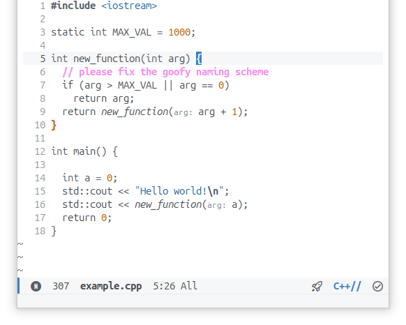
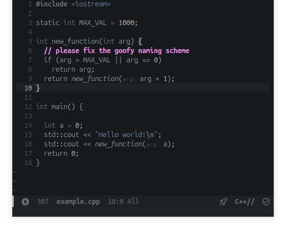

# Moondust Doom Emacs theme

Inspired by [moondust](https://github.com/vanyauhalin/moondusttheme) for Doom Emacs.




## Modifications
- Comments are [bright and high contrast](https://www.benkuhn.net/syntax/)
- orange number color (when using treesitter) following [more planets](https://github.com/vanyauhalin/moondusttheme/issues/3) discussion

## Using these themes
Both themes are self contained `.el` files, as long as they are in your theme load path you will be able to use them.

I have them in `~/.config/doom/themes/` \
and added the folder in `config.el`

``` emacs-lisp
(add-to-list 'custom-theme-load-path
             (expand-file-name "themes/" doom-user-dir))

(setq doom-theme 'moondust-dark)
;; (setq doom-theme 'moondust-light)
```

## Contributing
If you see a problem with the highlighting please make a PR or open an issue!
